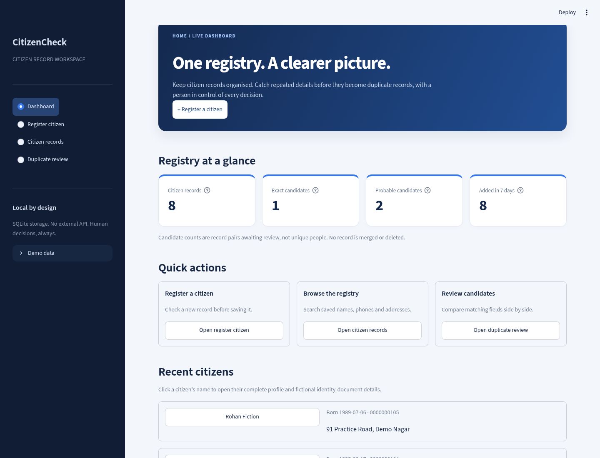

# Intelligent Duplicate Citizen Record Detection System

**CitizenCheck** is a small, local Python project for a college demonstration. Register citizen records, detect exact duplicates with SHA-256, and screen probable duplicates with RapidFuzz. A person makes every decision. No face recognition, document analysis, chatbot, paid API or machine-learning model.



## Start here

**You need Python 3.10 or newer.** Python 3.10 was used for testing. Internet is needed once to install packages. After installation, the application and its SQLite database run locally, without an external service.

Download this repository with **Code > Download ZIP** and extract it, or clone it:

```bash
git clone https://github.com/HemanthSursh/Duplicate-Citizen-Detection.git
cd Duplicate-Citizen-Detection
```

Then open a terminal in the folder containing `app.py`.

### Windows (PowerShell or Command Prompt)

```powershell
py -m venv .venv
.venv\Scripts\python -m pip install -r requirements.txt
.venv\Scripts\python -m streamlit run app.py
```

### macOS / Linux

```bash
python3 -m venv .venv
.venv/bin/python -m pip install -r requirements.txt
.venv/bin/python -m streamlit run app.py
```

Open the local URL printed by Streamlit, usually `http://localhost:8501`. Keep the terminal open. Press **Ctrl+C** in that terminal to stop the app. To run it again, use just the final command above.

The main local dashboard has no login. The optional REST API requires an API key. The server binds to `127.0.0.1`, so it is intended for your own computer, not a public deployment.

## Four simple screens

- **Dashboard:** actual SQLite record totals, exact/probable candidate pairs awaiting review, records added in the rolling last seven days, clickable recent citizens, registration activity and navigation shortcuts.
- **Register citizen:** name, date of birth, phone and address. Validate first, check candidates, then save. Flagged records require a separate review step, a reason and explicit confirmation. Cancel does not save anything.
- **Citizen records:** search records by name, phone or address. Click a name to open the full citizen profile. Internal IDs stay hidden in lists and are available only in the profile's internal-details section.
- **Duplicate review:** compare candidate pairs side by side, see field scores and save either `Confirmed duplicate` or `Distinct records` with a note. Both records remain untouched. Reviewed pairs leave the pending dashboard counts but remain in the Reviewed/All candidates views.

IDs are generated automatically as `CIT-` plus 12 random hexadecimal characters. Each saved record has a UTC creation timestamp.

## Try the fictional demo

The first launch starts with an empty database. In the sidebar, open **Demo data** and click **Load fictional demo**. This adds eight explicitly fictional records once. Phone strings starting with `000` are demonstration values, not contact numbers. The fixture includes `DEMO-AAD-...` and `DEMO-DL-...` fictional identity-document references. These are not real document numbers.

On a fresh database this produces:

| Metric | Value |
| --- | ---: |
| Citizen records | 8 |
| Exact candidate pairs | 1 |
| Probable candidate pairs | 2 |
| Added in the last seven days | 8 |

These numbers describe the sample fixture, not constants in the application. Dashboard values are recomputed from saved records and decisions. A reviewed pair no longer counts as pending.

Open [the three-minute demo guide](docs/DEMO_GUIDE.md) for a presentation walkthrough.

## Clickable citizen profiles and fictional documents

Internal record IDs are not shown in dashboard or registry lists. Click a citizen's name to open their full profile: name, birthday, phone, address, optional fictional Aadhaar reference and optional fictional driving-licence reference. Open **Internal record details** inside that profile for the internal ID, fingerprint, normalized JSON and registration note.

The registration form has an optional document-reference section. It accepts only clearly fictional `DEMO-AAD-...` and `DEMO-DL-...` references, not real Aadhaar or licence numbers. These references are display-only and **do not change the four-field duplicate fingerprint or fuzzy matching rule**. There are no document uploads or verification/forgery features. Older local databases receive the two new optional columns automatically without changing their existing records or fingerprints.

## How exact detection works

The four fields are selected together: name, date of birth, phone and address.

1. Validate every required value.
2. Apply Unicode NFKC normalization and collapse repeated whitespace.
3. Case-fold name and address for comparison. Preserve readable casing in the stored display values.
4. Store the birthday as `YYYY-MM-DD` and reject invalid/future dates.
5. Strip phone spaces, parentheses and hyphens. A leading `+` is ignored for matching. Require 7–15 ASCII digits. **No country code is added or removed.** Use the same country-code convention across records.
6. Serialize named fields with `json.dumps(..., sort_keys=True, ensure_ascii=False, separators=(",", ":"))`.
7. Hash the UTF-8 bytes with SHA-256.
8. Query the indexed fingerprint before saving. The fingerprint index remains **not unique** to preserve existing/demo records. New registrations are separately guarded by the phone-uniqueness rule.

Sorted-key JSON is deterministic and unambiguous. It avoids collisions caused by joining fields with a delimiter that can also appear in the data. An exact hash match identifies identical normalized field values, not a verified real-world identity. The UI shows matching citizen names and fields. Click a name to inspect the internal record ID in the profile details.

New registrations using a phone number already in the registry are blocked with **Phone number already exists.** Phone formatting and a leading `+` do not bypass the rule; country codes are not inferred. This is an explicit phone-uniqueness rule, not a fuzzy-score decision. Existing records are never deleted. The intentionally duplicated fictional demo fixture is loaded through its separate explicit demo-data operation.

A SQLite `BEGIN IMMEDIATE` transaction checks phone availability and rechecks matches under a write lock at save time. If another session has added a new candidate since the preview, saving stops and the user must review the changed matches.

## How probable detection works

| Field | Comparison | Weight |
| --- | --- | ---: |
| Full name | RapidFuzz `token_sort_ratio` | 40% |
| Date of birth | Equal = 100, different = 0 | 25% |
| Phone | Equal = 100, different = 0 | 20% |
| Address | RapidFuzz `token_sort_ratio` | 15% |

A non-exact pair becomes **Probable** when the weighted score is at least 78/100 **and** the name score is at least 65/100. Exact pairs are not counted again as probable. Scores are similarity measures, **not probabilities**, accuracy claims or proof of identity. The weights and threshold are simple demonstration rules defined in `citizen/matching.py`.

The system can miss duplicates, especially when phone, birthday or country-code conventions differ. People with shared details can be flagged incorrectly. It never merges or deletes records or rejects a person solely because of a similarity score. The separate phone-uniqueness rule blocks registrations with an existing phone.

## Storage and safety

- Database: `storage/citizens.sqlite3`, created automatically on first run.
- Data and review decisions persist after restarting the app.
- `citizens` stores record details, fingerprint, creation time, registration review note and optional fictional document references.
- `reviews` stores pair IDs, decision, note and review time. One saved decision per unordered pair; later reviews update that decision.
- `settings` prevents accidentally loading the demo twice.
- SQL statements use parameters for record values.
- No database, secrets, environment files or virtual environment belong in Git. `.gitignore` excludes them.
- This is **not a production citizen database**: API-key authentication protects API calls only, not the dashboard. No tenant isolation, role permissions, encryption, regulatory compliance, external identity checks or immutable audit log. SHA-256 here is a matching fingerprint, not encryption. Names, addresses, birthdays and phones remain readable in SQLite. Use fictional data only.
- Fuzzy registration is O(n); pair scanning is O(n²). This straightforward implementation suits a small college demo, not a large national registry.

To reset your own demo: stop Streamlit, back up anything you want to keep, delete the `storage` folder, then start again. This permanently removes records and decisions from that local database. There is no destructive reset button in the UI.

For an isolated database, set `CITIZEN_DB` to another file path before launching. Tests always use temporary databases.

## Run tests

Windows:

```powershell
.venv\Scripts\python -m pytest -q
```

macOS / Linux:

```bash
.venv/bin/python -m pytest -q
```

Tests cover normalization, deterministic serialization, all fingerprint fields, validation, exact/probable matching, SQLite persistence/indexing, stale-review protection, review decisions, live dashboard counts, and the Streamlit registration/search/review UI.

## Project map

```text
app.py                       Streamlit pages and review flow
citizen/
  matching.py                Validation, normalization, SHA-256 and fuzzy rules
  database.py                SQLite storage and registration transactions
  demo.py                    Fictional sample records
  documents.py               Optional fictional document-reference validation
sample_data/citizens.csv      The same fictional fixture, for reference
.streamlit/config.toml        Local server and theme settings
tests/                       Pytest and Streamlit UI tests
docs/                        Screenshots, demo guide and design notes
requirements.txt             Tested direct dependency versions
```

No image models, large assets or external services are required. Screenshots are examples with fictional records; actual IDs and timestamps vary.

## Git and GitHub

The app is kept separate from any earlier project. To version your own copy:

```bash
git init
git add .
git commit -m "Build focused duplicate citizen record detector"
```

Create a **new empty repository** in your own GitHub account, then use the exact remote URL GitHub gives you. Do not paste passwords or tokens into source files, command history, issues or README files. Publishing is a separate step from running locally.

No project-code license has been selected. Dependency licenses remain with their respective authors.

## REST API and separate integration demo

See [API integration guide](docs/API.md) for complete setup, commands for Windows/macOS/Linux, endpoint contracts, curl examples, authentication, safe errors, manual review and production limits.

The API calls the existing `Registry.check` / transactional `Registry.register` and unchanged `citizen/matching.py`. The dashboard and API use the same database path. No second customer database is created. The separate sample client uses real HTTP calls and does not import the registry or detector.

New files: `api/main.py` (routes, byte limits, safe logging), `api/models.py` (contracts), `api/security.py` (key), `citizen/config.py` (shared path), `citizen/service.py` (privacy-limited explanations), `sample_client/app.py` and `sample_client/client.py` (separate demo). New tests cover the API and sample client.

## Hosting the full app (demo)

`Dockerfile` and `deploy/` run the dashboard and the REST API in one container behind one public port, so both use the same SQLite file. The dashboard is at `/`, the API at `/api/v1/...` and `/docs`. Set `CITIZEN_API_KEY` (32+ characters) as an environment variable on the host; if it is unset, a random key is generated at start and the API key cannot be used from outside. On free hosts the SQLite file resets on restart, so use fictional data only.
